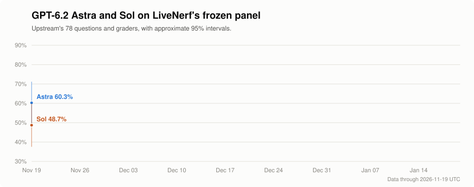
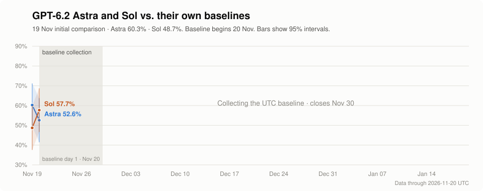

# LiveNerf for Codex results

Daily monitoring of GPT-6.2 Astra and Sol through the Codex CLI. Each
run uses the same ten public compute questions. The grader awards
partial credit, and each model gets a baseline after ten complete days.
This panel tracks daily scores while a drift study would require a
calibrated panel.

<picture>
  <source media="(prefers-color-scheme: dark)" srcset="daily-dark.svg">
  
</picture>

[Daily scores CSV](daily.csv)

## Pilot

[Pilot chart](pilot.svg)

[18 November 2026 pilot scores CSV](pilot.csv)

## Acknowledgements

The Codex study builds on the benchmark and reporting approach by
ninjahawk and the LiveNerf contributors. The test harness uses Inspect,
developed by the UK AI Security Institute and Meridian Labs. OpenAI
provides the Codex CLI and GPT-6.2 models. [LiveNerf](https://github.com/ninjahawk/livenerf) · [Inspect](https://inspect.aisi.org.uk/)

When citing a result, use the run date and the commit from this branch.

## Upstream frozen panel comparison

<picture>
  <source media="(prefers-color-scheme: dark)" srcset="comparison/8ad04dd62da4845f/daily-dark.svg">
  
</picture>

[Scores CSV](comparison/8ad04dd62da4845f/daily.csv) · [Panel, run settings and dated Claude references](comparison/8ad04dd62da4845f/comparison.json)

## Drift study e4fd3e8126ea3472

<picture>
  <source media="(prefers-color-scheme: dark)" srcset="drift/e4fd3e8126ea3472/daily-dark.svg">
  
</picture>

[Daily scores CSV](drift/e4fd3e8126ea3472/daily.csv)

[Coverage, baseline sensitivity and drift decisions](drift/e4fd3e8126ea3472/study.json)

[Instrument validation and measured sensitivity](drift/e4fd3e8126ea3472/validation.json)

[Frozen panel summary and predicted sensitivity](drift/e4fd3e8126ea3472/design.json)
