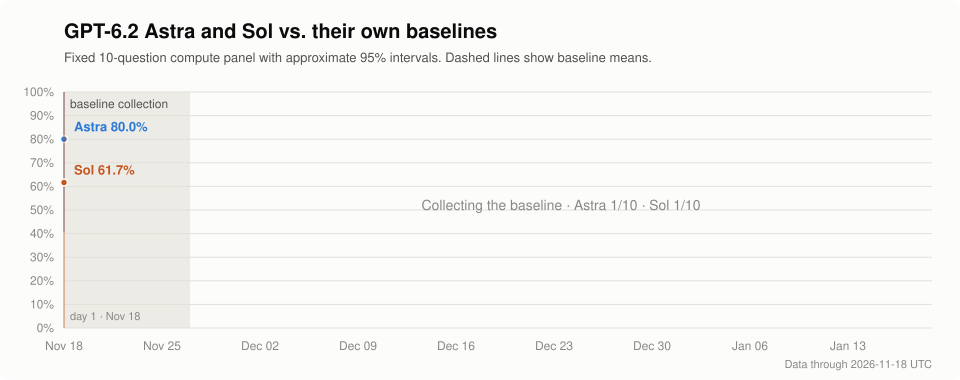

# LiveNerf for Codex

A fork of [LiveNerf](https://github.com/ninjahawk/livenerf) that studies
GPT-6.2 Astra and Sol as served through the Codex CLI.

[Results](https://github.com/akmalulkhairin/livenerf/tree/codex-results) ·
[Daily scores CSV](https://github.com/akmalulkhairin/livenerf/blob/codex-results/daily.csv) ·
[Upstream study](https://github.com/ninjahawk/livenerf)

<picture>
  <source media="(prefers-color-scheme: dark)" srcset="https://raw.githubusercontent.com/akmalulkhairin/livenerf/codex-results/daily-dark.svg">
  
</picture>

## Study status

The chart shows the ten-question public compute monitor. Monitoring is paused
while we calibrate a separate panel for the drift study. Astra is the primary
model and Sol is the candidate control. The drift study will collect a fresh
baseline after calibration and validation.

## Acknowledgements

LiveNerf for Codex builds on the benchmark and study design by ninjahawk and
the [LiveNerf contributors](https://github.com/ninjahawk/livenerf). The test
harness uses [Inspect](https://inspect.aisi.org.uk/), developed by the UK AI
Security Institute and Meridian Labs. The fork retains the upstream
[MIT licence](LICENSE).

When citing a Codex result, include the run date and the commit from the
[results branch](https://github.com/akmalulkhairin/livenerf/tree/codex-results).
